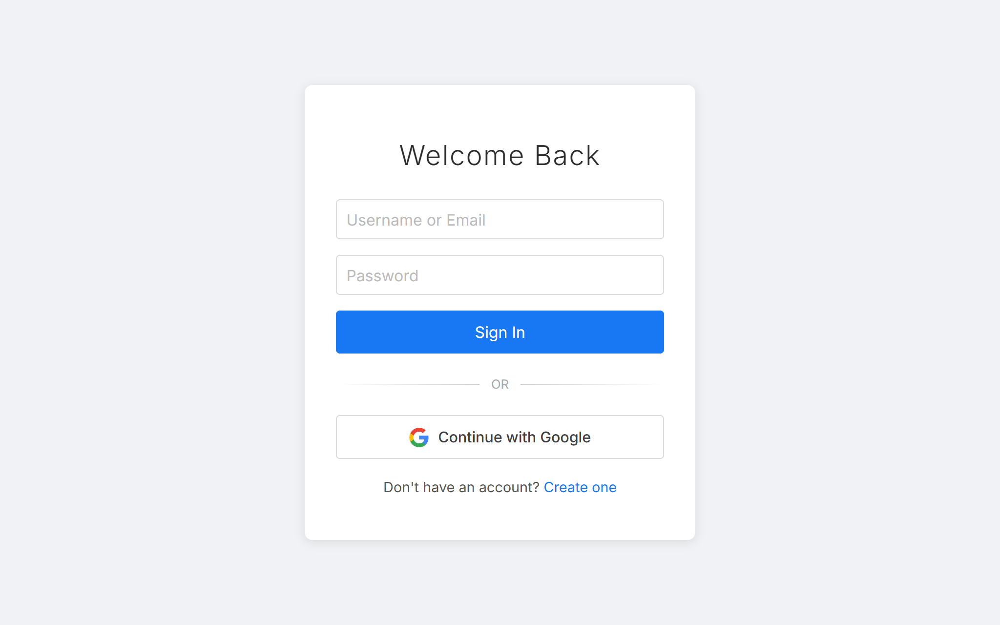
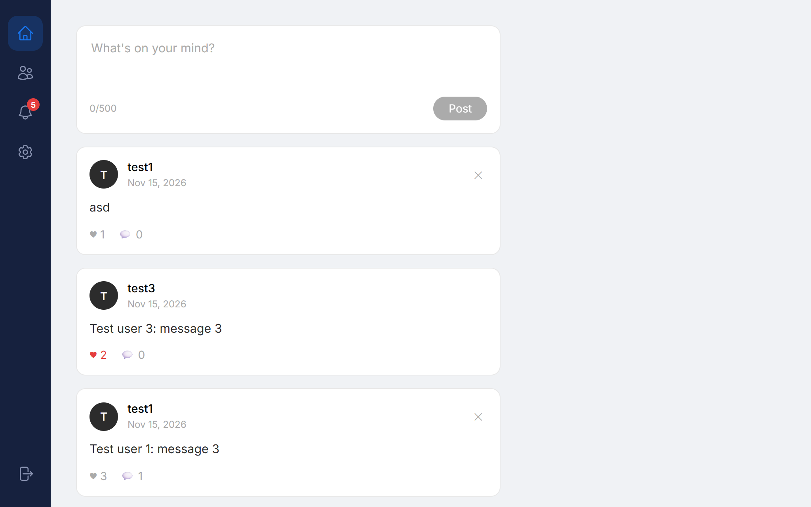
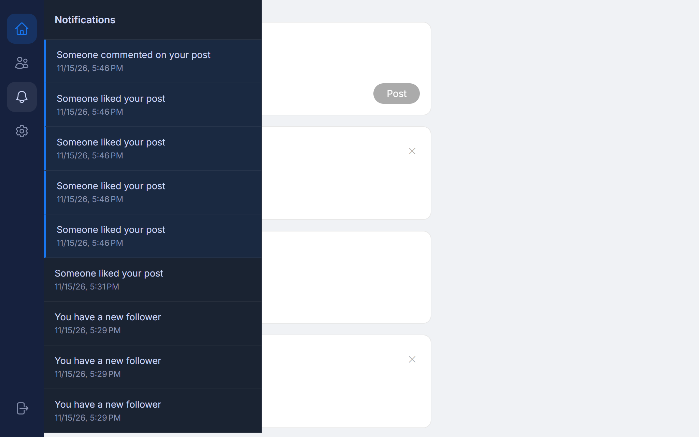
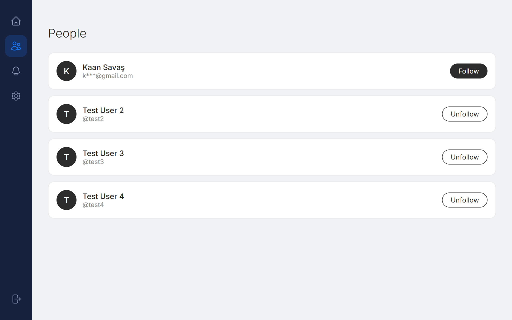
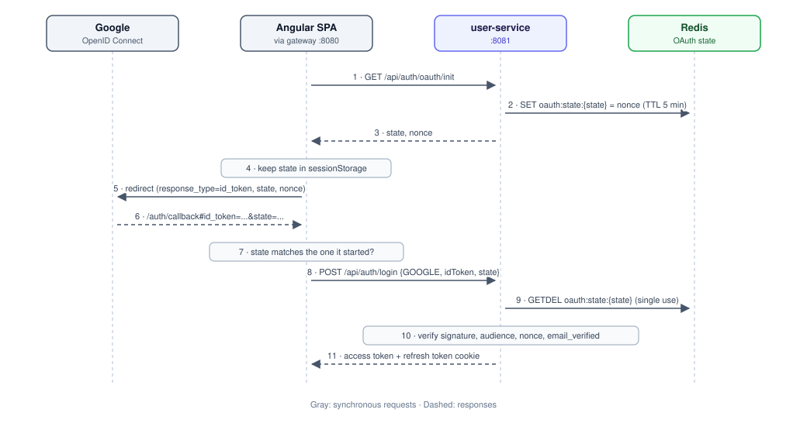
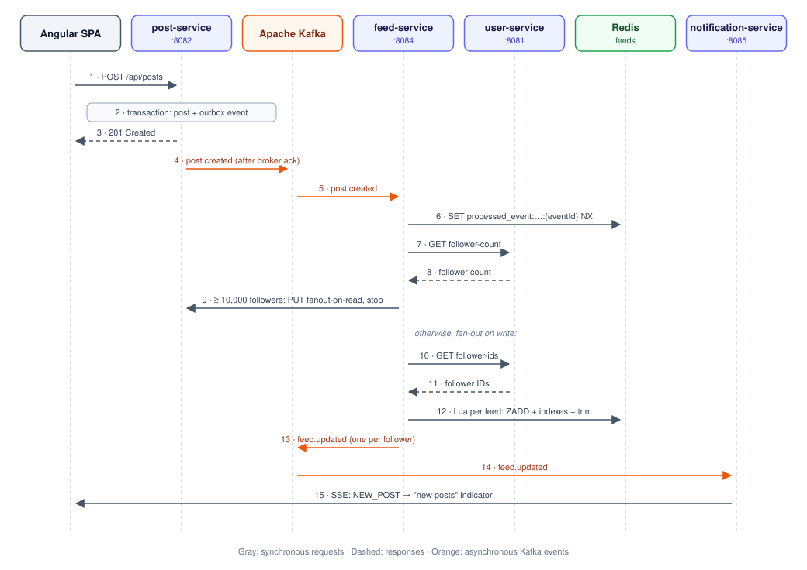
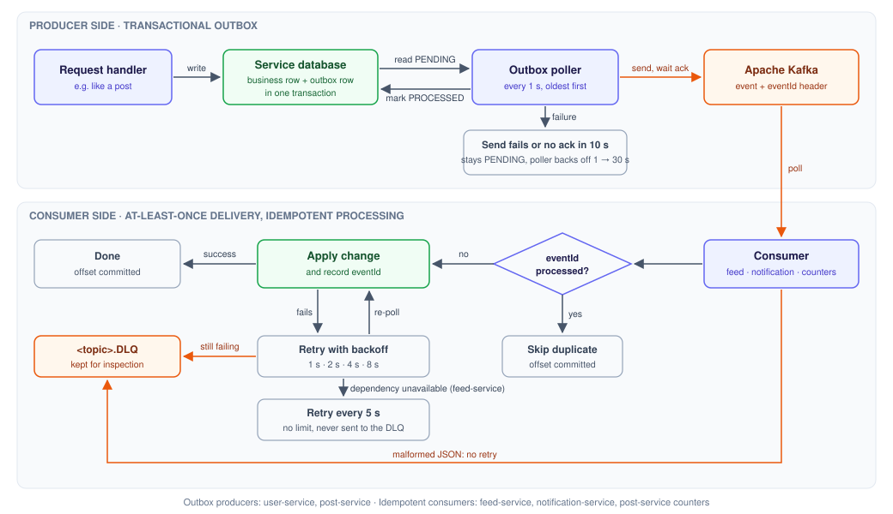

# **Social Media Platform**

A social network developed as a system design project, consisting of four Spring Boot microservices behind an API gateway, Kafka, PostgreSQL, MongoDB, Redis and an Angular frontend. Users can register locally or with Google, follow other users, publish posts, like and comment, and receive a personalized home feed with real-time notifications.

The project focuses on the architecture behind the feed rather than on product features: a read-optimized feed precomputed in Redis, a hybrid fan-out model (fan-out on write for regular accounts, fan-out on read for accounts with a large number of followers), reliable event delivery through the Transactional Outbox pattern, idempotent consumers, hot-key contention, and the behavior of the system when one of its components fails.

| Area | Technology |
|---|---|
| **Backend** | Java 25, Spring Boot 4 (MVC, WebFlux, Security, Data JPA / MongoDB / Redis / R2DBC, Kafka), Spring Cloud Gateway |
| **Architecture** | Microservices, event-driven communication over Kafka |
| **Data stores** | PostgreSQL, MongoDB (replica set), Redis |
| **Frontend** | Angular 21, TypeScript, HTML/SCSS |
| **Tests** | JUnit 6 + Mockito |

## **Screenshots**

<table>
  <tr>
    <td align="center"><sub>Sign in (local account or Google)</sub></td>
    <td align="center"><sub>Home feed</sub></td>
  </tr>
  <tr>
    <td width="50%"><a href="docs/screenshots/login.png"></a></td>
    <td width="50%"><a href="docs/screenshots/feed.png"></a></td>
  </tr>
  <tr>
    <td align="center"><sub>Real-time notifications over SSE</sub></td>
    <td align="center"><sub>People and follow graph</sub></td>
  </tr>
  <tr>
    <td width="50%"><a href="docs/screenshots/notifications.png"></a></td>
    <td width="50%"><a href="docs/screenshots/people.png"></a></td>
  </tr>
</table>

## **Requirements and scale**

### **Current state**

The system is deployed on a single host with Docker Compose, running one instance per service, two PostgreSQL instances, a single Kafka broker, a single-node MongoDB replica set and a single Redis node.

The architecture targets 1M daily active users, while the current implementation is sized for 100K. The changes required to reach the target are listed under [Known gaps for 1M DAU](#known-gaps-for-1m-dau).

All features operate end to end, and the failure scenarios described below were executed against this environment. The system has not been load-tested; therefore all figures in this section are estimates rather than measurements.

### **Non-functional requirements**

| Requirement | Target | Approach |
|---|---|---|
| Feed read latency | p99 < 200 ms | Feeds are precomputed with fan-out on write; fan-out on read is limited to high-follower accounts |
| Write latency | p99 < 300 ms | Requests commit only the change and its outbox event; downstream processing is asynchronous |
| Availability | 99.99 % | Circuit breakers isolate failing dependencies; feed reads degrade gracefully and writes continue during a Kafka outage |
| Scalability | Horizontal scaling of the request path | Stateless JWT authentication and bounded feeds; SSE delivery and outbox polling do not scale horizontally yet (see [Known gaps](#known-gaps-for-1m-dau)) |

### **Back-of-the-envelope estimation**

**Assumptions:** 10 reads and 2 writes per user per day, of which 0.5 are posts; 200 followers per user, 86,400 s per day, peak = 3 × average.

| Metric | Calculation | Target: 1M DAU | Current: 100K DAU |
|---|---|---|---|
| Read QPS | DAU × 10 / 86,400 s | 116 (peak 347) | 12 (peak 35) |
| Write QPS | DAU × 2 / 86,400 s | 23 (peak 69) | 2 (peak 7) |
| Read/write ratio | 10 reads : 2 writes per user | 5 : 1 | 5 : 1 |
| Fan-out writes | DAU × 0.5 × 200 / 86,400 s | 1,157/s (peak 3,472/s) | 116/s (peak 347/s) |

**Note:** The current project runs in a local Docker Compose environment; therefore, its actual capacity does not meet the target.

## **Running locally**

Prerequisites: Docker Engine with Docker Compose v2 (e.g. Docker Desktop for local environments).

```bash
docker compose up -d --build
```

The frontend is served at `http://localhost:4200`. The seeded accounts `test1` … `test4` use the password `test`; on first start, a one-off `seed` container adds follows and sample posts through the public APIs.

| URL | Service |
|---|---|
| `http://localhost:4200` | Frontend |
| `http://localhost:8080` | API gateway |
| `http://localhost:8081` · `8082` · `8084` · `8085` | user · post · feed · notification service (direct access, see below) |
| `http://localhost:8090` | Kafka UI |
| `http://localhost:8091` | Mongo Express |
| `http://localhost:8092` | Adminer (PostgreSQL) |
| `http://localhost:5540` | Redis Insight |

Configuration is supplied through environment variables in `docker-compose.yml`, with local defaults in each service's `application.properties` (`JWT_SECRET`, `CELEBRITY_FOLLOWER_THRESHOLD`, the gateway's `CORS_ALLOWED_ORIGINS`, …).

<details>
<summary style="cursor:pointer"><b>Configuration options and tests</b></summary>

- **Custom frontend port:** add `FRONTEND_PORT=4300` to a `.env` file in the project root. The gateway accepts browser requests only from the frontend's origin, and `CORS_ALLOWED_ORIGINS` follows `FRONTEND_PORT`. Alternatively, `./scripts/start.sh` (Bash) picks `4200`, or `4300` if 4200 is in use.
- **Direct service ports:** `docker-compose.override.yml` publishes the service ports for local debugging and is loaded by default; add `COMPOSE_FILE=docker-compose.yml` to the `.env` file to expose only the gateway and the frontend.
- **Custom gateway port:** add `GATEWAY_PORT=8000` to the `.env` file; the frontend is built against the gateway URL, so restart with `--build`.
- **Google Sign-In (optional):** Create an OAuth 2.0 Web client with `http://localhost:4200/auth/callback` (and `http://localhost:4300/auth/callback`) as redirect URIs, then add `GOOGLE_CLIENT_ID=…` to a `.env` file in the project root before starting the system.
- **Test execution:** Run `mvn test` in each service directory. The user-service context test requires PostgreSQL (`docker compose up -d postgres`).

</details>

## **Architecture**

<a href="docs/architecture.svg?raw=true"></a>

- **Single entry point:** The Angular application reaches every service through the API gateway.
- **Microservices:** Four services, each with its own database; user-service and feed-service share the Redis instance but use separate keys.
- **Asynchronous integration:** State changes are propagated as Kafka events published through the Transactional Outbox pattern.
- **Synchronous integration:** feed-service retrieves data from user-service and post-service through internal REST endpoints.
- **Stateless authentication:** Each service validates the JWT independently; the services don't maintain HTTP sessions, therefore services can be scaled horizontally.

### **gateway-service · `:8080`**

**Responsible for:** Routing browser requests to the services; it is the only backend address the frontend uses.<br>
The gateway was added only for routing and is outside the main scope of the project, which focuses on the feed architecture. Rate limiting and SSL termination are not implemented and are left as future work.<br>
**Patterns:** *API Gateway*<br>
**Key dependencies:** *Spring Cloud Gateway (WebFlux), Spring Boot Actuator*

- **Path-based routing:** `/api/auth/**` and `/api/users/**` are routed to user-service, `/api/posts/**` to post-service, `/api/feed/**` to feed-service and `/api/notifications/**` to notification-service; target addresses come from configuration.
- **Streaming pass-through:** The reactive gateway forwards the SSE notification stream without buffering.
- **Health check:** Spring Boot Actuator exposes `/actuator/health`, which Docker Compose uses as the container health check.
- **Future work:** Rate limiting (a Redis token bucket keyed by user, after adding JWT validation at the gateway) and SSL termination (all traffic is plain HTTP locally).

### **user-service · `:8081`**

**Responsible for:** Registration, local and Google authentication, token management, user profiles and the follow graph.<br>
**Patterns:** *Strategy, Transactional Outbox, refresh token rotation*<br>
**Key dependencies:** *Spring MVC, Spring Data JPA, Spring Security, Spring Data Redis, Spring Kafka, JJWT, Google API Client*

- **Authentication through the Strategy pattern:** Local and OAuth sign-in are separate strategies, and each OAuth provider is a separate token verifier. A Microsoft verifier has been added on the server, but Microsoft sign-in is not implemented: the frontend offers only Google, and Microsoft client ID is not configured.
- **Short-lived access tokens and rotated refresh tokens:** Access tokens expire after 15 minutes. Refresh tokens are delivered in an `HttpOnly` cookie, stored only as hashes and rotated on every use; reuse of a previous token revokes the entire token family.
- **Google Sign-In (OpenID Connect):** Single-use `state` and `nonce` values are stored in Redis, and the ID token is validated server-side.
- **Atomic follow operation:** The follow record, the follower counter and the outbox event are committed in a single transaction.

<details>
<summary style="cursor:pointer"><b>Google Sign-In flow</b></summary>

<a href="docs/flow-google-sign-in.svg?raw=true"></a>

</details>

### **post-service · `:8082`**

**Responsible for:** Posts, likes, comments and their counters.<br>
**Patterns:** *Transactional Outbox, asynchronous counters, idempotent consumer, retry with jittered backoff*<br>
**Key dependencies:** *Spring MVC, Spring Data MongoDB, Spring Security, Spring Kafka, JJWT*

- **Elimination of hot-key contention:** Updating the like counter within the like transaction caused 9 of 10 concurrent likes to fail with write conflicts. To resolve this, counters are updated asynchronously by a dedicated consumer; all concurrent likes succeed and the counter converges to the correct value.
- **Idempotent counter updates:** Each processed event is recorded in the same transaction as the counter update; therefore redelivered events don't have any effect.
- **Retry of transient transaction errors:** Transient MongoDB transaction errors are retried with jittered exponential backoff; other errors fail immediately.

<details>
<summary style="cursor:pointer"><b>Like flow</b></summary>

<a href="docs/flow-like-post.svg?raw=true"></a>

</details>

### **feed-service · `:8084`**

**Responsible for:** Building and serving each user's home feed.<br>
**Patterns:** *Fan-out on write, fan-out on read (hybrid feed), circuit breaker, graceful degradation, idempotent consumer*<br>
**Key dependencies:** *Spring MVC (RestClient), Spring Data Redis (Lettuce), Spring Security, Spring Kafka, Resilience4j, JJWT*

- **Fan-out on write:** When a post is created, its ID is added to the feeds of the author and all followers in Redis.
- **Fan-out on read for high-follower accounts:** Posts from authors with at least a configurable number of followers (default 10,000) are not distributed; they are merged into the feed at read time.
- **Feeds store post IDs only:** Post content and counters are retrieved from post-service at read time, which keeps counters current.
- **Dependency isolation through circuit breakers:** feed-service wraps its REST calls to user-service and post-service in two separate Resilience4j circuit breakers. If user-service is unavailable, the feed is served from precomputed entries only; if post-service or Redis is unavailable, the service responds with `503`.

<details>
<summary style="cursor:pointer"><b>Post creation and feed read flows</b></summary>

**Post creation**

<a href="docs/flow-create-post.svg?raw=true"></a>

**Feed read**

<a href="docs/flow-read-feed.svg?raw=true"></a>

</details>

### **notification-service · `:8085`**

**Responsible for:** Storing notifications and pushing them to the browser in real time through Server-Sent Events (SSE).<br>
**Patterns:** *Real-time push (Server-Sent Events), reactive streams, idempotent consumer, retry with backoff and DLQ*<br>
**Key dependencies:** *Spring WebFlux, Project Reactor, Spring Data R2DBC, Spring Security, Spring Kafka, JJWT*

- **Real-time delivery over Server-Sent Events:** Each signed-in browser keeps one long-lived SSE connection. Events consumed from Kafka are pushed through a per-user reactive stream to every open tab: likes, comments and follows as notifications, and new feed posts as a "new posts" indicator. A heartbeat every 25 seconds keeps idle connections open through proxies.
- **Reactive stack for long-lived connections:** WebFlux and R2DBC serve open SSE connections without dedicating a thread to each connection.
- **Tokens are not used in URLs:** Since `EventSource` cannot send headers, the client exchanges its JWT for a short-lived, single-use stream ticket.
- **Server-managed unread state:** The unread count is maintained by the server, and opening the notification panel marks all notifications as read.

### **Kafka**

**Responsible for:** Propagating state changes between services.<br>
**Patterns:** *Transactional Outbox, at-least-once delivery, retry with exponential backoff, dead letter queue*

- **Prevention of dual writes:** Each business change and its outbox event are committed in the same transaction. A poller publishes pending events and marks them as processed only after broker acknowledgment; during a Kafka outage, events are retained and delivered in order once the broker recovers.
- **Parallel consumption with per-entity ordering:** Topics are created with 6 partitions and each listener runs 3 consumer threads; message keys route all events of the same post or follower to the same partition.
- **Idempotent consumers:** Every outbox event carries a unique identifier, and every consumer discards duplicates; `feed.updated` is published directly by feed-service and only triggers live notifications.

<details>
<summary style="cursor:pointer"><b>Topics and keys</b></summary>

| Topic | Producer | Consumers | Key |
|---|---|---|---|
| `user.followed` | user-service | feed-service, notification-service | follower ID |
| `user.unfollowed` | user-service | feed-service | follower ID |
| `post.created` | post-service | feed-service | post ID |
| `post.deleted` | post-service | feed-service | post ID |
| `post.liked` | post-service | notification-service, post-service counters | post ID |
| `post.unliked` | post-service | post-service counters | post ID |
| `comment.created` | post-service | notification-service, post-service counters | post ID |
| `feed.updated` | feed-service | notification-service | user ID |

</details>

<details>
<summary style="cursor:pointer"><b>Failure handling</b></summary>

| Failure | Handling |
|---|---|
| Processing error | Retried with exponential backoff, then published to the dead letter queue |
| Malformed message | Published to the dead letter queue immediately, as retrying cannot resolve it |
| feed-service dependency unavailable (user-service, post-service, Redis) | Retried without a limit, so a temporary outage never moves a valid event to the dead letter queue |

</details>

<details>
<summary style="cursor:pointer"><b>Delivery and retry flow</b></summary>

<a href="docs/reliability.svg?raw=true"></a>

</details>

### **Redis**

**Responsible for:** Storing precomputed feeds and short-lived keys for idempotency and OAuth.<br>
**Patterns:** *Precomputed read model, atomic Lua script, idempotency key with lease*

- **Feed storage in sorted sets:** Entries are ordered by post time, and the 1,000-entry limit bounds the size of each feed.
- **Atomic feed insertion:** The feed entry, both reverse indexes and the trim are applied in a single Lua script; therefore an insertion is never left partially applied.
- **Lease-based idempotency:** An event is claimed for a limited time before processing; if processing fails, the claim is released, and if the consumer crashes, the claim expires. In both cases the event is processed again.

<details>
<summary style="cursor:pointer"><b>Keys</b></summary>

| Key | Type | Purpose |
|---|---|---|
| `feed:{userId}` | Sorted set | User feed ordered by post time, limited to the newest 1,000 IDs |
| `author_posts_in_feed:{userId}:{authorId}` | Set | Posts of an author within a feed, used for unfollow cleanup |
| `post_feeds:{postId}` | Set | Feeds containing a post, used for deletion cleanup |
| `processed_event:feed-service:{eventId}` | String, TTL | Idempotency marker |
| `oauth:state:{state}` | String, TTL | Single-use sign-in state; the value is the expected nonce |

</details>

### **MongoDB**

**Responsible for:** Posts, likes, comments and the post-service outbox.<br>
**Patterns:** *Document model, multi-document transactions, TTL-based deduplication*

- **Rationale for a document database:** New post types (galleries, polls, link previews) can introduce their own fields without schema migrations, and posts, as the fastest-growing data set, can be sharded by author.
- **Replica set deployment for transactions:** Multi-document transactions require a replica set; likes, comments and posts are committed together with their outbox events.
- **Indexing strategy:** A unique index prevents duplicate likes, compound indexes support author and comment queries, and processed event records expire through a TTL index.

### **PostgreSQL**

Two separate instances: `social_db` holds users, the follow graph, refresh tokens and the user-service outbox; `notification_db` holds the notifications of notification-service.<br>
**Patterns:** *Relational integrity, Transactional Outbox, unique-index deduplication, reactive access (R2DBC)*

- **Rationale for a relational database:** Unique constraints on usernames and emails, a composite primary key for follows and cascading foreign keys guarantee the consistency of the follow graph.
- **Refresh token family management:** Tokens are stored as hashes grouped by family, and expired tokens are purged on a daily schedule.
- **Deduplication through unique indexes:** A unique index on the event identifier in notification-service rejects a redelivered event, so the notification is stored only once.

### **Frontend · `:4200`**

**Responsible for:** The user interface as an Angular single-page application, including registration, sign-in with Google, the home feed, the people list, profiles, settings and a real-time notification panel.<br>
**Patterns:** *Signals for state management, functional interceptor and guards, reconnect with exponential backoff*<br>
**Key dependencies:** *Angular Router, Angular Forms, RxJS*

- **Transparent token refresh:** An interceptor attaches the JWT to each request and, on `401`, refreshes the token and retries the request.
- **Resilient real-time updates:** When the SSE connection is lost, the client obtains a new ticket and reconnects with exponential backoff.

<details>
<summary style="cursor:pointer"><h2 id="failure-scenarios" style="display:inline;border-bottom:0;padding-bottom:0"><b>Failure scenarios</b></h2></summary>

The following scenarios were executed manually against the Docker Compose environment, in addition to the unit tests:

| Scenario | Result |
|---|---|
| 10 users like the same post concurrently | All requests were accepted; the counter reached exactly 10 |
| The same event is delivered twice | Stored notifications, counters and feeds remained unchanged |
| A malformed message is published to `post.liked` | The message was moved to `post.liked.DLQ` without retries |
| Kafka is stopped during follows and posts | API remained available; events were delivered after restart |
| user-service is stopped during a feed read | Feed was served from precomputed entries only |
| post-service is stopped during a feed read | `503` was returned |
| Redis is stopped during a feed read | `503` was returned within 2 s |
| Redis is stopped while a post is fanned out | The event was retried until Redis recovered, then delivered to all feeds |

</details>

<details>
<summary style="cursor:pointer"><h2 id="known-gaps-for-1m-dau" style="display:inline;border-bottom:0;padding-bottom:0"><b>Known gaps for 1M DAU</b></h2></summary>

- **Fan-out throughput:** Fan-out issues one Redis call per follower; pipelining or batching is required for the target fan-out rate.
- **Outbox throughput:** Each poller publishes at most 100 events per poll and waits for every acknowledgment individually; batched, asynchronous publishing is required.
- **Multiple outbox poller instances:** Pollers assume a single instance; running several requires row-level locking (`SELECT … FOR UPDATE SKIP LOCKED`) in user-service and atomic claims on the MongoDB outbox in post-service.
- **Redis Cluster:** Feeds at this scale exceed a single node; the Lua script spans multiple hash slots, and the reverse-index sets (`post_feeds`, `author_posts_in_feed`) are not trimmed together with the feed.
- **Distributed SSE delivery:** Connections and stream tickets are held in memory; Redis Pub/Sub is required to run several notification-service instances.

</details>
