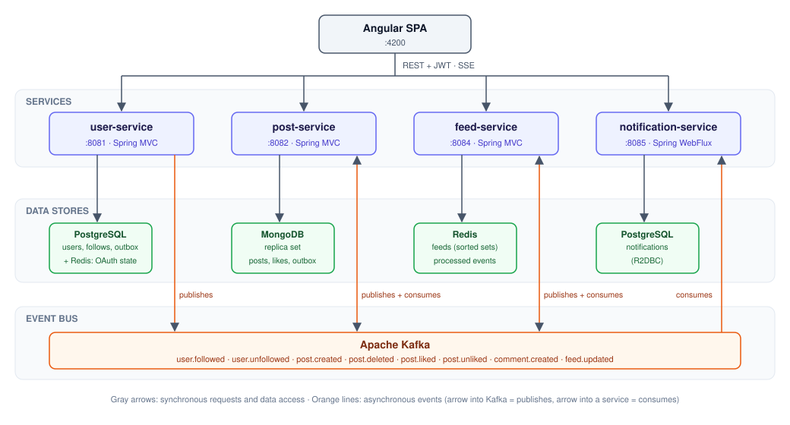
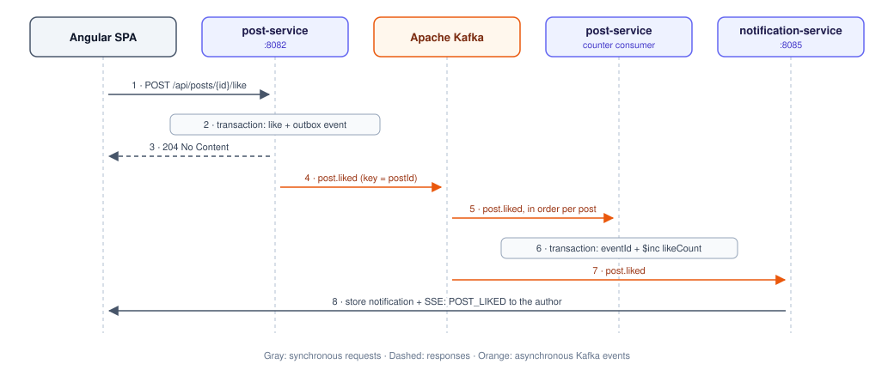
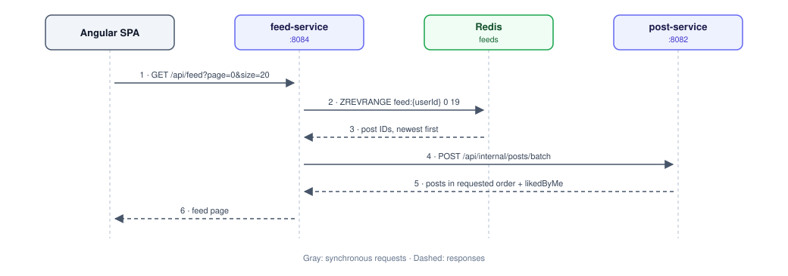

# Social Feed Platform

A social media backend designed the way real social networks are designed: users sign up (locally or with Google), follow each other, post, like and comment, and get a personalized home feed plus real-time notifications.

It is built as four Spring Boot microservices and an Angular frontend, communicating asynchronously through Apache Kafka and synchronously over REST, with each service using the data store that fits its access pattern. The focus is on the system design behind a feed: read-heavy optimization, reliable event delivery, idempotency, contention handling and failure recovery, all verified against the running system.

```bash
docker compose up --build
```

Open `http://localhost:4200` and sign in as `test1` … `test10` (password `test`).

## What this project demonstrates

| Area | Highlights |
|---|---|
| **System design** | Fan-out-on-write feed for a read-heavy workload, bounded precomputed feeds in Redis, hot-key contention removed with asynchronous counters, eventual consistency where it is acceptable, polyglot persistence |
| **Distributed systems reliability** | Transactional Outbox with broker acknowledgement, at-least-once delivery with idempotent consumers, exponential-backoff retries, Dead Letter Queues, retry of transient MongoDB transaction errors |
| **Backend engineering** | Java 25, Spring Boot 4 (Spring MVC, WebFlux, Security, Data JPA / MongoDB / Redis / R2DBC, Kafka), Strategy pattern for login and OAuth providers |
| **Data** | PostgreSQL, MongoDB replica set with multi-document transactions and TTL indexes, Redis sorted sets, reactive database access with R2DBC |
| **Security** | Stateless JWT authentication across services, Google OpenID Connect with server-issued single-use `state` + `nonce`, BCrypt |
| **Real-time** | Server-Sent Events from a reactive notification service |
| **Frontend** | Angular 21 with Signals, standalone components, functional guards and interceptors |
| **Delivery** | Multi-stage Dockerfiles, one-command Docker Compose setup with health-checked startup ordering |
| **Testing** | Test-driven backend development with JUnit 5 + Mockito (135 tests) |

## Architecture



feed-service also calls internal REST endpoints synchronously: user-service for follower IDs during fan-out, and post-service for an author's latest posts on follow and for post batches when a feed is read. These calls are shown in the flows below.

| Service | Responsibility | Storage |
|---|---|---|
| **user-service** | Registration, local and OAuth login, JWT issuance, profiles, follow graph | PostgreSQL, Redis |
| **post-service** | Posts, likes, comments, like/comment counters | MongoDB |
| **feed-service** | Builds and serves each user's home feed | Redis |
| **notification-service** | Stores notifications and pushes them live over SSE | PostgreSQL (R2DBC) |

Each service owns its data; no service reads another service's tables. Data is shared through Kafka events or internal REST endpoints. Identity travels inside the JWT, so services hold no HTTP session state.

## Key design decisions

### 1. Read-heavy feed: fan-out on write

A post is written once but read many times by every follower. The cost is therefore paid at write time:

- When a post is created, feed-service pushes its ID into the feed of the author and of every follower. Reading the home feed is one Redis sorted-set range query, not a "collect posts from everyone I follow and sort" query.
- Each feed is a Redis sorted set scored by the post's creation time and trimmed to the newest 1,000 entries, so reading a page costs O(log N + page size) with N capped.
- Feeds store only post IDs. Content, counters and "liked by me" are loaded from post-service in a single batch request that preserves the feed order, so counts are current at read time instead of being copied into every feed.
- On follow, the followed user's latest 50 posts are backfilled into the follower's feed; on unfollow they are removed. Helper sets (`author_posts_in_feed:*`, `post_feeds:*`) make unfollow and post deletion targeted instead of scanning feeds.
- The fan-out runs in a Kafka consumer, so creating a post returns as soon as it is stored.

### 2. Reliable events: Transactional Outbox

Writing to the database and publishing to Kafka are two separate systems; doing both in a request can leave one without the other (the dual-write problem). Instead:

- user-service (JPA) and post-service (MongoDB multi-document transaction) write the business change and an `outbox_events` record **in the same transaction**.
- A poller sends pending events to Kafka and marks them `PROCESSED` **only after the broker acknowledges** the write. If Kafka is unavailable, events stay `PENDING` and are delivered once it is back, in order.
- Each event carries its outbox ID as an `eventId` Kafka header, which consumers use for deduplication.

### 3. At-least-once delivery with idempotent consumers

The outbox guarantees *at-least-once* delivery: after a crash or a retry the same event can arrive twice. Every consumer is therefore idempotent:

| Consumer | Mechanism |
|---|---|
| post-service counters | Inserts the `eventId` into a `processed_events` collection (unique `_id`, TTL 7 days) in the same transaction as the counter update; a duplicate insert aborts the update |
| notification-service | `event_id` column with a unique index; a duplicate insert is treated as "already processed" and nothing is pushed |
| feed-service | Records processed `eventId`s in Redis (7-day TTL) and skips known events; the Redis feed operations themselves (`ZADD`, `SADD`, `ZREM`) are also naturally idempotent |

### 4. Hot-key contention: asynchronous counters

A like originally ran in one transaction that inserted the like and incremented `likeCount` on the post document. Under load test, 10 concurrent likes on the same post produced MongoDB write conflicts and only 1 of 10 succeeded: every transaction was competing for the same *hot document*.

The fix removes the contention instead of retrying around it:

- The like transaction now only inserts the like and an outbox event. These are new documents, so concurrent likes no longer conflict.
- A dedicated consumer in post-service applies `post.liked`, `post.unliked` and `comment.created` events to the counters with atomic `$inc`. Events are keyed by post ID, so all events of one post land on the same Kafka partition and are applied sequentially.
- Counters become eventually consistent, typically within milliseconds; the frontend already updates the count optimistically.

After the change, the same test accepts all 10 concurrent likes and the counter converges to exactly 10.

### 5. Transient transaction errors are retried

MongoDB recommends retrying a transaction that fails with the `TransientTransactionError` label (write conflicts, primary failover, network blips). Spring's `@Transactional` does not do this, so post-service runs its writes through a small `TransactionRunner` that retries only errors with this label, up to 5 attempts with jittered exponential backoff. Non-transient errors such as duplicate keys fail immediately.

### 6. Consumer retries and Dead Letter Queues

- Failed records are retried 4 times with exponential backoff (1 s, 2 s, 4 s, 8 s).
- Malformed messages (JSON parsing errors) are classified as non-retryable and go straight to the DLQ, since retrying cannot fix them.
- Records that still fail are published to `<topic>.DLQ` by `DeadLetterPublishingRecoverer`. feed-service also has a `DlqConsumer` for its own DLQ topics, with a separate consumer group and error handler so a failing DLQ record cannot loop back into a DLQ.

Decisions 2, 3 and 6 together form the event delivery path:


### 7. Polyglot persistence and why posts use MongoDB

PostgreSQL holds relational data with strong integrity needs (users, the follow graph). Redis holds feeds and short-lived OAuth state. Posts live in MongoDB.

Today's post model (text, author, counters, timestamps) could be stored in a relational database without any problem. MongoDB was chosen for where the post model is heading:

- **Heterogeneous post types.** Planned post types carry very different data: image galleries and videos (each with their own media metadata such as dimensions, duration and thumbnails), polls (options and votes), link shares (URL preview data), and reposts/quote posts (an embedded reference to another post). In SQL this becomes either one wide table full of nullable columns or a growing set of join tables; in a document store each post carries the fields of its own type.
- **Schema evolution without migrations.** New post types and fields (hashtags, mentions, location, edit history, reaction types) can be introduced gradually; old and new documents live side by side.
- **Read-together data stays together.** A post and what is needed to render it can be read as a single document, which fits the read-heavy feed.
- **Horizontal scaling.** Posts are the fastest-growing dataset; MongoDB's native sharding (for example by `authorId`) offers a direct path to scale.

MongoDB runs as a single-node replica set, which is what enables multi-document transactions for the outbox.

### 8. Reactive notifications over SSE

notification-service is built on Spring WebFlux and R2DBC, so holding many long-lived SSE connections does not tie up a thread per connection. Each connected user has an in-memory Reactor sink shared by all of their open tabs; it is released only when the last tab disconnects. Kafka events are consumed with a Spring Kafka listener that waits for the reactive save to complete, so failures are retried and dead-lettered instead of being lost.

### 9. Authentication

- user-service signs JWTs (HS256, 24 h) containing the username and `userId`; the other services verify the signature and expiry on their own, without calling user-service.
- Login uses the **Strategy pattern**: `AuthService` picks a `LoginStrategy` (`LocalLoginStrategy`, `OAuthLoginStrategy`) by provider, and OAuth providers are separate `OAuthTokenVerifier` implementations (Google, Microsoft). Adding a provider means adding one class.
- **Google Sign-In** (OpenID Connect):
  - user-service issues a random `state` and `nonce`, stored in Redis for 5 minutes and consumed on first use.
  - The browser keeps the `state` in `sessionStorage` and rejects a callback whose `state` it did not start, which protects against login CSRF.
  - The ID token's signature, expiry and audience are verified server-side, its `nonce` must match, and Google accounts must have a verified email.
  - An OAuth login cannot take over an email already registered with a different method. OAuth users get a BCrypt-hashed random password, so password login stays impossible until they set one.


### 10. Time handling

All timestamps are `Instant` (UTC) end to end, serialized as ISO-8601 with `Z`. Feed scores use the post's creation time carried in the event, so posts backfilled on follow and posts fanned out live are ordered on the same clock regardless of server time zones.

## Service communication

| Topic | Producer | Consumers | Payload |
|---|---|---|---|
| `user.followed` | user-service | feed-service, notification-service | `followerId`, `followingId` |
| `user.unfollowed` | user-service | feed-service | `followerId`, `followingId` |
| `post.created` | post-service | feed-service | `postId`, `authorId`, `createdAt` |
| `post.deleted` | post-service | feed-service | `postId`, `authorId` |
| `post.liked` | post-service | post-service (counters), notification-service | `postId`, `userId`, `authorId` |
| `post.unliked` | post-service | post-service (counters) | `postId`, `userId`, `authorId` |
| `comment.created` | post-service | post-service (counters), notification-service | `commentId`, `postId`, `authorId`, `postAuthorId` |
| `feed.updated` | feed-service | notification-service | `userId`, `postId` |
| `<topic>.DLQ` | consumer error handlers | feed-service `DlqConsumer` (feed topics); others are inspected in Kafka UI | original record |

Outbox events are keyed by aggregate ID (follower ID for follow events, post ID for post and like events, comment ID for comment events), so related events keep their order within a partition. Synchronous calls go through internal REST endpoints under `/api/internal/**` (follower IDs, post batches).

### Creating a post


### Liking a post



### Reading the feed



## Services in detail

### user-service (`:8081`)

Spring Web, Spring Data JPA, Spring Security, Spring Data Redis, Spring Kafka, Bean Validation, JJWT, `google-api-client`, Nimbus JWT decoder (Microsoft).

| Method | Path | Description |
|---|---|---|
| `POST` | `/api/auth/register` | Register a local user, returns a JWT |
| `GET` | `/api/auth/oauth/init` | Create OAuth `state` + `nonce` |
| `POST` | `/api/auth/login` | Login with `LOCAL`, `GOOGLE` or `MICROSOFT` |
| `PATCH` | `/api/users/me` | Update username, password (and email for local users); returns a new JWT |
| `GET` | `/api/users` | Other users with "following" flags |
| `GET` | `/api/users/{id}` | Profile with follower/following counts |
| `POST` / `DELETE` | `/api/users/{id}/follow` | Follow / unfollow |
| `GET` | `/api/internal/users/{id}/follower-ids` | Internal: follower IDs for fan-out |

### post-service (`:8082`)

Spring Web, Spring Data MongoDB, Spring Security, Spring Kafka, Bean Validation, JJWT. Indexes are created from the document mappings: unique `postId + userId` on likes, `authorId + createdAt` and `createdAt` on posts, `postId` on comments, `status` on outbox events, TTL on processed events.

| Method | Path | Description |
|---|---|---|
| `GET` / `POST` | `/api/posts` | List all posts, newest first / create a post |
| `GET` / `DELETE` | `/api/posts/{id}` | Get / delete (author only) |
| `POST` / `DELETE` | `/api/posts/{id}/like` | Like / unlike |
| `GET` / `POST` | `/api/posts/{id}/comments` | List / add comments |
| `GET` | `/api/internal/posts/by-author/{authorId}` | Internal: latest post summaries of an author |
| `POST` | `/api/internal/posts/batch` | Internal: posts by IDs in the requested order |

### feed-service (`:8084`)

Spring Web, Spring Data Redis, Spring Kafka, Spring Security, JJWT, `RestClient`.

| Redis key | Type | Purpose |
|---|---|---|
| `feed:{userId}` | Sorted Set | The feed, scored by post creation time, newest 1,000 entries |
| `author_posts_in_feed:{userId}:{authorId}` | Set | Posts of an author in a user's feed, removed on unfollow |
| `post_feeds:{postId}` | Set | Feeds containing a post, cleaned on post deletion |
| `processed_event:feed-service:{eventId}` | String (TTL) | Idempotency marker |

API: `GET /api/feed?page={page}&size={size}`.

### notification-service (`:8085`)

Spring WebFlux, Spring Data R2DBC, `r2dbc-postgresql`, Spring Security (WebFlux), Spring Kafka, Project Reactor, JJWT. Notification types: `FOLLOWED`, `POST_LIKED`, `COMMENT_CREATED` (stored) and `NEW_POST` (pushed live only).

| Method | Path | Description |
|---|---|---|
| `GET` | `/api/notifications/stream?token={jwt}` | SSE stream (the browser's `EventSource` cannot send headers) |
| `GET` | `/api/notifications` | Notification history, newest first |
| `PUT` | `/api/notifications/{id}/read` | Mark as read |

### Frontend (`:4200`)

Angular 21 single-page application: combined register / sign-in page with "Continue with Google", home feed (compose, like, delete own posts, "new posts" banner), people list, profiles with follow/unfollow, settings and a live notification panel. State is managed with Signals; a functional interceptor attaches the JWT and functional guards protect routes.

## Verified behavior

Besides the unit tests, the following scenarios were run against the full Docker Compose stack:

| Scenario | Result |
|---|---|
| Posts backfilled on follow and posts fanned out afterwards | Feed returned newest first across both |
| 10 users liking the same post concurrently | All 10 accepted, counter converged to exactly 10 |
| One user sending 10 concurrent likes | One `204`, nine `409`; counter not double-counted |
| The same `post.liked` event redelivered with its `eventId` | Consumed by both consumer groups, counter and notification count unchanged |
| The same `post.created` event redelivered | No duplicate `feed.updated`; the same message without `eventId` did produce one, confirming the check is what blocks it |
| Malformed JSON published to `post.liked` | Reached `post.liked.DLQ` without retries |
| Follow and post created while Kafka was stopped | API kept responding; events stayed `PENDING` and were delivered after Kafka restarted |
| Two SSE connections for one user, one closed | The remaining connection kept receiving notifications |
| OAuth callback with a `state` the browser did not start | Rejected without calling the backend |

## Getting started

### With Docker (recommended)

Requirements: Docker.

```bash
docker compose up --build
```

| URL | What |
|---|---|
| `http://localhost:4200` | Frontend (sign in as `test1` … `test10`, password `test`) |
| `http://localhost:8090` | Kafka UI |
| `http://localhost:8091` | Mongo Express |
| `http://localhost:8092` | Adminer (PostgreSQL) |
| `http://localhost:5540` | Redis Insight |

Google Sign-In is optional. To enable it, create an OAuth 2.0 Client ID (Web application) with `http://localhost:4200/auth/callback` as an authorized redirect URI and start with:

```bash
GOOGLE_CLIENT_ID=your-client-id.apps.googleusercontent.com docker compose up --build
```

### Running services locally

Requirements: Java 25, Maven, Node.js. Start the infrastructure only, then each service in its own terminal:

```bash
docker compose up -d zookeeper kafka postgres mongodb redis
cd user-service && mvn spring-boot:run
cd post-service && mvn spring-boot:run
cd feed-service && mvn spring-boot:run
cd notification-service && mvn spring-boot:run
cd frontend && npm install && npm start
```

Configuration is read from environment variables with local defaults (`DB_URL`, `MONGO_HOST`, `REDIS_HOST`, `KAFKA_BOOTSTRAP_SERVERS`, `JWT_SECRET`, `GOOGLE_CLIENT_ID`, ...). The defaults are for local development only.

### Tests

```bash
cd <service-directory>
mvn test
```

The user-service controller tests start the full Spring context and need PostgreSQL running (for example via `docker compose up -d postgres`).

## Trade-offs and next steps

Deliberate simplifications for the current scale, and what would change at a larger one:

- **No API gateway yet.** The SPA calls services directly and `/api/internal/**` endpoints are not authenticated; a gateway (planned for cloud deployment) would expose only public routes.
- **SSE sinks are in memory**, so notification-service runs as a single instance; scaling out would fan notifications across instances with Redis Pub/Sub.
- **Pure fan-out on write.** Accounts with very large follower counts would need a hybrid model (pull their posts at read time).
- **Single-instance outbox pollers.** Running several instances would need poller coordination (e.g. a lock or `SELECT … FOR UPDATE SKIP LOCKED`); duplicates are already absorbed by idempotent consumers.
- **`feed.updated` is published directly** rather than through an outbox, since it only drives a transient "new posts" banner.
- **DLQ messages are logged, not replayed** automatically.
- **Denormalized author username** in posts and comments is not updated when a user renames; deleting a post does not remove its likes and comments.
- **Comments** are supported by the API but not yet shown in the UI; `GET /api/posts` is not paginated (the UI uses the paginated feed).
- **Feed trimming** keeps feeds at 1,000 entries but does not clean the related helper sets.
